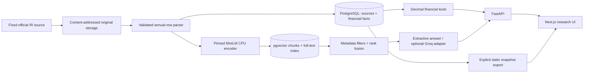

# Architecture — implemented milestone 1

The database is authoritative for facts; the static JSON is a reproducible, timestamped export. It does not write data back or pretend to be live retrieval. Original files and cached model weights stay local and ignored. The citation store resolves financial answers to fact IDs and retrieval answers to chunk IDs, both linked to source versions and row locators.

## Replaceable boundaries

- `DocumentStorage` exposes `put/get`; `LocalStorage` is implemented. An S3 adapter is future work.
- `EmbeddingProvider` exposes `identifier/encode`; the pinned 384-dimension ONNX MiniLM implementation checks artifacts and stores its identity in every chunk. Changing it requires validated dimensions and reindexing.
- `ModelProvider` exposes bounded question/evidence generation; Groq is the single optional implementation. No SDK receives arbitrary SQL, URLs or shell tools.
- `database.session.engine/session_scope` centralizes SQLAlchemy connections, transactions and the environment-selected PostgreSQL URL.
- `semi ingest` is a synchronous local command. The local-runner/Fargate job contract and persisted LangGraph checkpoints will be implemented with the bounded workflow, not represented as working services now.

## Boundaries deliberately not implemented

There is no LangGraph agent, background worker, queue, cloud adapter, Terraform deployment, valuation or trading. Research notes in the UI are explicitly analyst-authored, not agent-produced. Before the workflow milestone, add job IDs, idempotency keys, database-backed state/checkpoints, cancellation, retries/timeouts, token/cost ceilings and per-demo usage enforcement. PostgreSQL owns research data/checkpoints; a future DynamoDB table may own only queue-facing status/idempotency records.

The loopback API is a local prototype. It has one active question at a time, Pydantic input bounds, fixed outbound source/provider URLs and no unrestricted model tools. It is not authenticated or approved for public exposure. Public-hosting hardening and durable model budgets must precede deployment.
